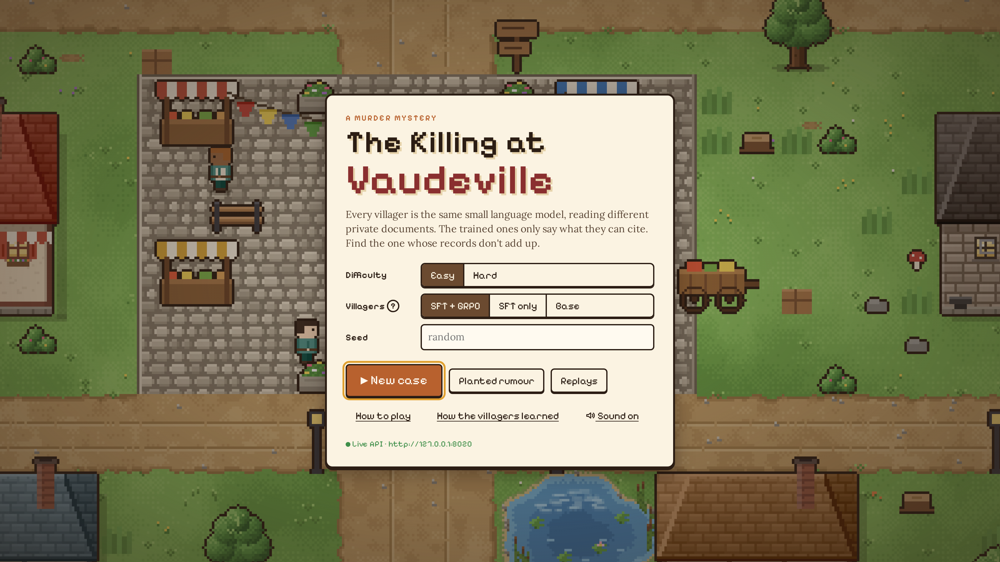
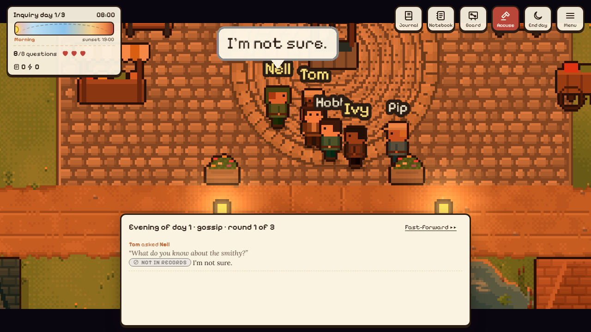
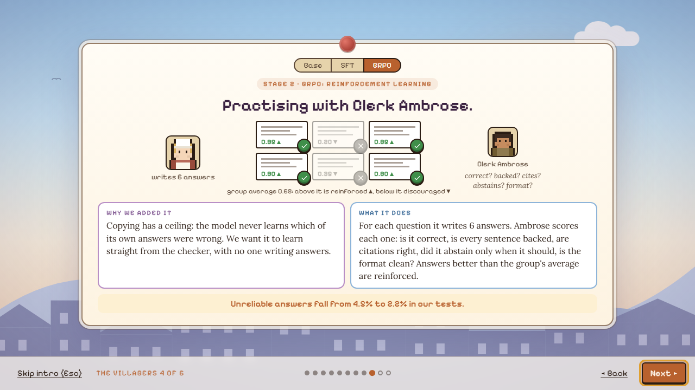
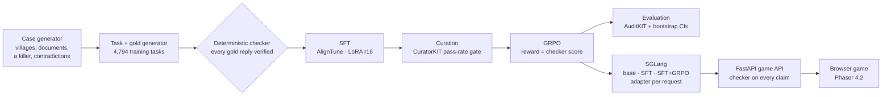

<p align="center">
  
</p>

<h3 align="center">A murder mystery where every villager is the same small LLM,<br>trained to say only what its own records can prove.</h3>

<p align="center">
  
  
  
  
  
  
</p>

<p align="center">
  <b>Untrained:</b> 72% of claims made up &nbsp;·&nbsp; <b>SFT + GRPO:</b> 0.2% &nbsp;·&nbsp; <b>accuracy</b> 11% → 98%
</p>

---

Small local language models sound confident while inventing facts. **The Killing at Vaudeville** turns that problem into a game. Every villager is the same model, **Qwen3-1.7B**, reading different private documents: diaries, ledgers, patrol logs, letters. One of them is the killer. You can only solve the case if the villagers stick to what they actually wrote down.

We fine-tuned the model (**SFT, then GRPO with a programmatic reward**) to answer only from its own records, **cite the exact sentence**, and say **"not in my records"** when the answer is not there. A **deterministic checker** (plain Python, no LLM judge) stamps every claim green, red or grey, both in training and live in the game.

<table>
  <tr>
    <td width="50%"><p align="center"><sub>The village of Vaudeville, drawn entirely in code</sub></p></td>
    <td width="50%"><p align="center"><sub>Evening gossip: the camera cuts in on each conversation</sub></p></td>
  </tr>
  <tr>
    <td><p align="center"><sub>The opening explains why SFT and GRPO exist</sub></p></td>
    <td><p align="center"><sub>Planted rumour: who repeats the killer's lie?</sub></p></td>
  </tr>
</table>

## Contents

- [The problem](#the-problem)
- [Headline results](#headline-results)
- [How it works](#how-it-works)
- [The game](#the-game)
- [Full results](#full-results)
- [Tech stack](#tech-stack)
- [Quick start](#quick-start)
- [Reproduce the pipeline](#reproduce-the-pipeline)
- [Repository layout](#repository-layout)
- [Game API](#game-api)
- [Documentation](#documentation)

## The problem

**Problem Statement 3, grounded answers and fewer hallucinations:** build a training set from an organisation's own documents and train a model that answers only from them, says so when the answer is not there, and makes measurably fewer unsupported or false claims.

| Problem statement | In Vaudeville |
| --- | --- |
| The organisation | The village |
| Its documents | Each villager's diaries, ledgers, letters and patrol logs |
| "Answers only from them" | A villager states only what its own records say, and cites the line |
| "Says so when it is not there" | `I'm not sure` / `not in my records` instead of a guess |
| "Measurably fewer unsupported claims" | The checker's unsupported-claim rate, before and after training |

Any team that wants a private assistant over its own documents (policies, case files, manuals, records) hits the same wall. In a murder case, one invented sentence is a false alibi or a wrong accusation. In a company, it is a wrong policy answer or a fabricated record.

## Headline results

Qwen3-1.7B, scored by the checker, greedy decoding, 95% bootstrap confidence intervals by case.

| | Untrained (R0) | SFT + GRPO (R3) |
| --- | :---: | :---: |
| Unsupported-claim rate, unseen cases | 72.0% | **0.2%** |
| Answer accuracy, unseen cases | 11.0% | **98.1%** |
| Unsupported claims under attack (injections, false premises, pressure) | 67.8% | **0.0%** |
| Accuracy on question wordings never seen in training | 8.6% | **85.0%** |
| Free-form player questions: supported claims | 34% | **99%** |
| Detective bot solves the case | 0% | **50%** |
| Detective bot catches the killer | 60% | **100%** |
| Villagers who repeat the killer's lie as fact (of 4) | 3.8 ¹ | **0.05** |

¹ The base model with an ordinary game-NPC prompt. The trained villagers pass the lie on **with attribution** ("Tom said...") 3.65 times out of 4 instead.

**SFT vs GRPO, honestly.** SFT does most of the work. GRPO, trained on the prompts the SFT model sometimes failed, **halves sampled failures (4.5% → 2.2%)**. A control run with *more SFT on the same prompts* did not help and overfit, so the gain comes from the reward, not from extra data. Details in [Full results](#full-results).

## How it works



### 1. A world with ground truth
`archive/world/` generates complete murder cases from a seed: villagers with jobs and personas, a timeline, sightings, a forged alibi for the killer, red herrings and a motive. Every sentence of every document is tied to a **fact id**, so the truth of any claim is known exactly. Easy mode has 6 villagers over 3 days; Hard has 8 villagers over 2 days, witnesses who only saw a role, and a killer who lies.

### 2. A checker strict enough to trust
`archive/verifiers/checker.py` parses each reply into claims with citations (`CLAIM: ... [D2.S1]`) and checks each one against the cited line. It rejects wrong citations, pronouns instead of names, more than one fact per claim, negations missing from the line, reversed who-saw-whom, fact and entity mismatches, unattributed hearsay, and vague or garbled text. It is the **reward during training, the referee during evaluation, and Clerk Ambrose in the game**.

### 3. Data, SFT and GRPO
| Stage | What happens |
| --- | --- |
| Data | `archive/tasks/` turns cases into question tasks with gold replies: direct questions, nearest-line and near-miss questions, false premises, pressure and format attacks, hearsay, and unanswerable questions. Every gold reply passes the checker (verified on 1.4M candidates over 1,600 extra cases). |
| SFT (R1) | LoRA r16 on 4,794 tasks through AlignTune's TRL backend, prompts pre-rendered with the exact inference chat template. |
| Curation | CuratorKIT samples the SFT model 4 times per task through SGLang and keeps the 148 prompts it *sometimes* fails, where a reward has something to teach. |
| GRPO (R3) | 100 steps, 6 sampled replies per prompt, reward = checker score: correct, supported, cites, abstains only when it should, format, length. Answers above the group's average are reinforced. |
| Evaluation | AuditKIT with the checker as custom scorers, per-villager chat adapter, greedy decoding, bootstrap CIs by case. |

### 4. One server, three villages
SGLang serves Qwen3-1.7B with both adapters loaded. The game picks the adapter **per request**: no adapter for *Untrained*, `r1b` for *SFT*, `r3` for *SFT + GRPO*. The FastAPI game API runs the NPC engine, gossip and rumours, and checks every claim on the CPU before the browser sees it.

## The game

| | |
| --- | --- |
| **Opening** | A dusk title page, a night cold open (someone in Vaudeville has been killed), a dawn briefing, then six pages on *why* the villagers were trained, what SFT and GRPO each do, and what Planted Rumour tests. Its own music. |
| **Investigate** | Walk the village, enter buildings, question villagers. Every claim arrives with a seal: **green** (in their records, with the exact source line), **red** (not in their records, with the reason), **grey** ("I'm not sure"). |
| **Notebook and Board** | Pin green claims, link two that cannot both be true. The Clerk confirms real contradictions. |
| **Accuse** | Two confirmed contradictions plus the motive (hidden in the victim's evidence). Wrong accusations cost strikes. |
| **Evening gossip** | Villagers walk to each other and talk. The camera cuts in on each conversation and the answer flies to the listener as a word coloured by its seal. Green gossip can go in your notebook. Fast-forward plays the evening at 4x, music included. |
| **Planted rumour** | The killer (played by the untrained model) frames someone, or you write a traveller's whisper. Five rounds of gossip, everyone asked the same question each round, a scoreboard at the end. Compare runs an untrained village beside an SFT + GRPO one. |
| **Villages** | Switch between Base, SFT only and SFT + GRPO on the title screen. The same seed replays the same case. |
| **Difficulty** | Easy: 6 villagers, 3 days, badges shown. Hard: 8 villagers, 2 days, badges hidden (Verify instead), a lying killer. |
| **Everything else** | Journal with a profile per villager, interiors for every building, townsfolk and animals, a day clock with lighting, villager voices (Kokoro TTS), replays and transcript export. |

**Controls:** `WASD`/arrows or click to walk · `E` talk · `N` notebook · `B` board · `J` journal · `Esc` menu.

There are **no asset files**: every building, interior, tree, character and portrait is drawn procedurally on canvas at boot, and all ambience, music and sound effects are synthesised with the Web Audio API.

## Full results

All numbers are from [`docs/RESULTS.md`](docs/RESULTS.md).

### Runs

| Run | What it is |
| --- | --- |
| R0 | Untrained base model, same prompt |
| R1a | SFT on the first data (1,678 templated tasks) |
| R1 = R1b | SFT on the fixed data (4,794 tasks: varied wording, nearest-line, near-miss, pressure, format attacks, hearsay conflicts, persona `#` lines) |
| **R3** | R1b + GRPO, 100 steps, checker reward, on the 148 prompts R1b sometimes failed |
| R3sft | Control: R1b + more SFT on the same 148 prompts (gold replies, 3 epochs) |
| R3b | GRPO round 2 on paraphrased prompts (over-answered; not used) |

Test sets: `test_id` (same generator, unseen cases), `test_adv` (injections, false premises, pressure, format attacks), `test_free` (unseen cases and wording family B, never seen in training).

### 1. Official evaluation (AuditKIT, greedy, 95% bootstrap CIs by case)

| Split | Run | Unsupported-claim rate ↓ | Answer accuracy ↑ | Abstain precision | Abstain recall | Robustness | Parse |
| --- | --- | :---: | :---: | :---: | :---: | :---: | :---: |
| `test_id` (633) | R0 | 0.720 [0.669, 0.768] | 0.110 [0.079, 0.136] | 0.624 | 0.249 | 0.435 | 0.643 |
| | R1 | 0.004 [0.000, 0.009] | 0.974 [0.959, 0.988] | 0.955 | 0.991 | 0.986 | 1.000 |
| | **R3** | **0.002** [0.000, 0.006] | **0.981** [0.966, 0.993] | 0.968 | 0.991 | 0.986 | 1.000 |
| `test_adv` (237) | R0 | 0.678 [0.590, 0.747] | 0.197 [0.127, 0.263] | 0.845 | 0.341 | 0.546 | 0.700 |
| | R1 | 0.000 | 0.984 [0.947, 1.000] | 0.994 | 0.989 | 1.000 | 1.000 |
| | **R3** | **0.000** | **0.984** [0.947, 1.000] | 0.994 | 0.983 | 1.000 | 1.000 |
| `test_free` (633) | R0 | 0.721 [0.665, 0.771] | 0.086 [0.060, 0.112] | 0.691 | 0.288 | 0.420 | 0.597 |
| | R1 | 0.013 [0.006, 0.024] | 0.835 [0.789, 0.875] | 0.839 | 0.947 | 0.913 | 1.000 |
| | **R3** | **0.009** [0.002, 0.018] | **0.850** [0.802, 0.888] | 0.867 | 0.920 | 0.899 | 1.000 |

Untrained villagers make up 68-72% of their claims; trained ones under 1.3%.

### 2. Does GRPO beat SFT?

"Exact" = the right abstain decision, all claims supported, all gold facts present. "Reliable@k" = the same question answered right in all k sampled tries (T = 0.8), as in the game, which samples.

| | R1b (SFT) | R3sft (SFT + more SFT) | **R3 (SFT + GRPO)** |
| --- | :---: | :---: | :---: |
| val exact | 0.978 | 0.981 | **0.984** |
| test_id exact | 0.979 | 0.975 | **0.984** |
| test_adv exact | **0.987** | 0.962 | 0.983 |
| test_free exact | 0.875 | 0.872 | **0.878** |
| reliable@4, val | 0.955 | 0.955 | **0.978** |
| reliable@4, test_free | 0.810 | 0.820 | **0.829** |
| reliable@6, test_game | 0.953 | | **0.962** |

More SFT on the very prompts GRPO trained on does not help (it overfits; `test_adv` drops to 0.962), while GRPO on the same prompts improves every split but one and **halves sampled failures on val (4.5% → 2.2%)**. The gains are small because SFT on perfect, generated gold replies is already strong, and the CIs of R1 and R3 overlap on single splits.

### 3. Free-form player questions

20 hand-written question kinds on unseen game cases (`archive/eval/probe_free.py`).

| | R0 | R1a | R1b | **R3** |
| --- | :---: | :---: | :---: | :---: |
| Invented answers | 17 | 34 | 1 | **1** |
| Abstained although the records answer | 26 | 113 | 1 | **0** |
| Claims supported | 34% | 79% | 98% | **99%** |

### 4. Game-level

**Detective bot** (scripted bot, 30 `test_game` cases; Hard killers are the untrained liar in both villages):

| Village | Solved (killer + 2 contradictions) | Caught the killer | Killer claims flagged red |
| --- | :---: | :---: | :---: |
| Base | 0% [0, 0] | 60% [43, 77] | 96% |
| **Grounded (R3)** | **50%** [33, 67] | **100%** | 51% |

**Manipulative killer** (20 runs; how many of 4 villagers repeat the killer's lie as fact after 5 rounds):

| Village | Repeat it as fact | Pass it on with attribution | Rebut it from own records |
| --- | :---: | :---: | :---: |
| Plain NPC prompt (base model) | 3.8 | | |
| R1b (SFT) | 0.0 | | |
| **R3 (SFT + GRPO)** | **0.05** | 3.65 | 0.55 |

**Planted traveller rumour** (20 runs, 6 villagers): base 0.4 repeat it as fact, R3 0.3 (and 1.15 pass it on attributed). The untrained village barely engages, so this number understates the difference, which is why the manipulative-killer mode exists.

**End to end through the game API** (same seed): the SFT + GRPO and SFT villages are solvable (10-12 confirmed contradictions, correct accusation); the base village yields 1 green claim and is unsolvable.

## Tech stack

| Layer | What we used |
| --- | --- |
| Model | Qwen3-1.7B, LoRA r16 adapters, thinking mode off |
| Training | **AlignTune** (TRL 1.7 backend) for SFT and GRPO, PEFT, transformers |
| Data curation | **CuratorKIT**: gold-check gate and pass-rate gate sampling through SGLang |
| Evaluation | **AuditKIT**: custom checker scorers, per-villager chat adapter, bootstrap CIs |
| Serving | **SGLang 0.5.9**, one server, LoRA adapter chosen per request |
| World, checker, data | Python 3.11, pydantic v2: case generator, solver, strict parser, checker, contradiction check, rewards, metrics, detective bot, gossip and rumour engines |
| Tests | pytest + Hypothesis property tests (1,400+ tests) |
| Game backend | FastAPI, with an in-browser mock fallback so the game always runs |
| Voices | Kokoro-82M TTS, one voice per villager |
| Game | Phaser 4.2, plain ES modules, no build step; procedural canvas art; Web Audio music and sound |
| Infrastructure | 4x RTX A6000 (48 GB) shared through Slurm, uv-managed environments, torch 2.9.1+cu128 |
| QA | Playwright/Chromium headless runs of full cases |

## Quick start

**Play right now, no GPU needed.** The game falls back to an in-browser mock when no API answers.

```bash
git clone https://github.com/antrip03/syntax_error26.git
cd syntax_error26
python scripts/static_nocache.py 5173 game      # open http://localhost:5173
```

**Run the tests** (Python 3.11):

```bash
uv venv --python 3.11 && source .venv/bin/activate      # Windows: .venv\Scripts\activate
uv pip install -e ".[dev]"                              # add ,tokenizer for the token-budget tests
pytest -q
```

**Play with the real models** on a GPU node (SGLang with both adapters, the game API and the web server, each in tmux):

```bash
scripts/serve_game.sh       # game on :5173, API on :8000
```

URL flags: `?offline=1` forces the mock, `?backend=api` forces the API, `?api=http://host:port` points at another API, `?debug` draws physics bodies. Over SSH: `ssh -L 5173:localhost:5173 -L 8000:localhost:8000 user@server`.

## Reproduce the pipeline

```bash
python -m archive.tasks.generate --config configs/data.yaml                            # cases + tasks + gold
scripts/gpu.sh python -m archive.train.sft  --config configs/sft.yaml                 # R1
python -m archive.train.curate --config configs/curate.yaml                            # prompts for GRPO
scripts/gpu.sh python -m archive.train.grpo --config configs/grpo.yaml [--resume]     # R3
python -m archive.eval.run_eval --config configs/eval.yaml run_id=R3 lora=r3          # official eval
python -m archive.eval.gate          # SFT vs GRPO gate        python -m archive.eval.probe_free   # free-form probe
python -m archive.eval.final_runs    # bot and rumour          python -m archive.eval.manipulation # manipulative killer
```

Every run writes `artifacts/runs/<run_id>/` with its config, git hash and logs. Environment details and exact versions: [`docs/ENV_NOTES.md`](docs/ENV_NOTES.md).

## Repository layout

```
archive/
  world/        case generator, renderer, personas, solver, lexicon
  verifiers/    strict reply parser, checker, contradiction check
  tasks/        prompts, task and gold generation, phrasing families
  rewards/      reward terms and their combination (the GRPO reward)
  train/        curation, SFT, GRPO, paraphrasing
  eval/         metrics, official eval, SFT-vs-GRPO gate, probes, bot and rumour runs
  npc/          detective bot, evening gossip, planted rumour
  adapters/     SGLang client, AlignTune, CuratorKIT and AuditKIT adapters
  serve/        game API, stub API, TTS server
configs/        one YAML per stage (data, sft, curate, grpo, eval)
game/           the browser game (index.html, styles, js/, replays/)
scripts/        serving, GPU, smoke and timing scripts
tests/          pytest suite
docs/           results, environment notes, toolkit usage, images
```

## Game API

The browser talks only to the game API (`archive/serve/game_api.py`); the stub (`archive/serve/api.py`) and the in-browser mock (`game/js/mock.js`) return the same shapes.

| Route | Purpose |
| --- | --- |
| `POST /case` | New case: briefing, villagers, evidence, limits, state |
| `POST /ask` | Ask a villager: spoken lines, checked claims, questions left |
| `POST /pin` · `POST /verify` | Pin a green claim to the notebook · verify a claim (Hard) |
| `POST /link` | Check two claims for a contradiction |
| `POST /day/end` | Evening gossip: events with per-claim seals, hints, next day |
| `POST /accuse` | Accuse a suspect with linked contradictions and a motive |
| `POST /rumour` | Planted rumour: killer or traveller source, village, rounds |
| `GET /replay/{id}` | A recorded transcript |

Full field list in [`game/README.md`](game/README.md).

## Documentation

| Document | What it covers |
| --- | --- |
| [`docs/RESULTS.md`](docs/RESULTS.md) | Every result table and how to reproduce it |
| [`docs/ENV_NOTES.md`](docs/ENV_NOTES.md) | GPU server, environments, versions, gotchas |
| [`docs/TOOLKIT_USAGE.md`](docs/TOOLKIT_USAGE.md) | What SGLang, AlignTune, CuratorKIT and AuditKIT each do here |
| [`game/README.md`](game/README.md) | The game: running it, features, API contract |

<p align="center"><sub>Built for Syntax Error 2026, Local LLM Track.</sub></p>
