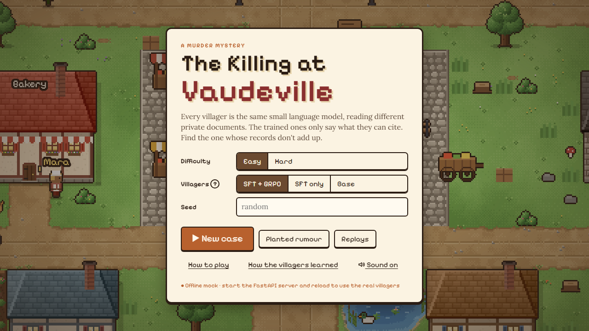

<p align="center">
  
</p>

# The Killing at Vaudeville: the game

A walkable pixel-art village in **Phaser 4.2** (Arcade Physics) with DOM overlays for questioning, the notebook, the contradiction board and accusations.

- **No build step.** Plain ES modules; Phaser loads from jsDelivr.
- **No asset files.** Buildings, interiors, trees, characters and portraits are drawn on canvas at boot (`js/art.js`, `js/art_extra.js`); ambience, music and sound effects are synthesised with Web Audio (`js/audio.js`).

## Run

```bash
python scripts/static_nocache.py 5173 game          # from the repo root, then open http://localhost:5173
```

The game calls the API at `http://localhost:8000` (set in `config.js`). If `/health` does not answer within 2.5 s it falls back to an **in-browser mock** (`js/mock.js`) with the same routes and shapes, so the game is always playable. The title screen shows which backend is active.

```bash
source scripts/env.sh serve && python -m uvicorn archive.serve.game_api:app --port 8000   # real models
python -m uvicorn archive.serve.api:app --port 8000                                        # canned stub
```

| URL flag | Effect |
| --- | --- |
| `?offline=1` | Force the in-browser mock |
| `?backend=api` | Force the API, no fallback |
| `?api=http://host:port` | Use another API |
| `?tts=http://host:port` | Villager voices server |
| `?debug` | Draw physics bodies |

## What is in it

| Feature | Details |
| --- | --- |
| **Opening** | Dusk title page, a night cold open, a dawn briefing, then pages on why SFT and GRPO were added, what each does, and what Planted Rumour tests (`js/ui/cinematic.js`, `cinematic.css`). Own music; `Space`/`Enter` next, `←` back, `Esc` skip. Replay it from *How to play*. |
| **Case flow** | Morning briefing → walk and question → claims with seals and quoted source lines → pin green claims → contradiction board → evening gossip → accuse → results. |
| **Seals** | Green: in their records (with the exact line). Red: not in their records (with the reason). Grey: "I'm not sure". Hard mode hides seals and offers Verify. |
| **Evening gossip** | Rounds of conversations; the camera cuts in on each pair, letterbox bars come in, and the answer flies to the listener as a word coloured by its seal. Green gossip claims can be added to the notebook. *Fast-forward* plays the rest at 4x with the music sped up. |
| **Planted rumour** | Source: the killer (untrained model, framing someone) or a traveller's whisper you write. Village: Untrained NPCs, SFT, SFT + GRPO, or Compare. Five rounds with close-ups and travelling words, a probe question each round, then a scoreboard (`js/ui/rumour.js`). |
| **Villages** | Base, SFT only, SFT + GRPO from the title screen; the same seed replays the same case. |
| **Interiors** | Mill, herb cottage, guildhall, chapel, inn, bakery and smithy can be entered. The crime scene (chalk outline and inspect point) follows the case. |
| **Villagers on the move** | Each case villager is in one place at a time, indoors or at an outdoor spot; spots re-roll each morning and villagers walk between them. |
| **Journal** (`J`) | A page per villager: portrait, role, personality, habits, live location, claim tally, pinned claims and your notes. |
| **Townsfolk and animals** | Vendors, guards, patrons, a kid, chickens, cats and a duck with canned small talk; they never call the backend. |
| **Day clock** | Cosmetic 08:00 to 19:00, driving the lighting from morning to sunset. |
| **Replays** | `replays/index.json` lists bundled transcripts; Menu → *Save transcript* records your own. |

**Controls:** `WASD`/arrows or click to walk · `E` talk · `N` notebook · `B` board · `J` journal · `Esc` menu.

## API contract

All calls go through `js/api.js`. JSON in, JSON out; errors are non-2xx with `{"detail": "message"}`, shown as a toast.

| Route | Request | Fields the game reads |
| --- | --- | --- |
| `GET /health` | | any 200 |
| `POST /case` | `{seed, difficulty, mode}` | `case_id, briefing, villagers[], evidence[], evidence_claims[], limits{}, state{}`; optional `victim`, `scene`, `scene_place` |
| `POST /ask` | `{case_id, villager_id, question}` | `speech[]`, `abstained`, `claims[claim]`, `questions_left` |
| `POST /pin` | `{claim_id}` | `ok`, `pinned[]`, `reason` |
| `POST /verify` | `{claim_id}` | `status`, `verifies_left`, `reason?` |
| `POST /link` | `{claim_a, claim_b}` | `confirmed`, `reason` |
| `POST /day/end` | `{case_id}` | `events[{round, asker, responder, question, reply, status, claims[claim], heard_id?, clash?}]`, `hints[]`, `day`, `game_over`, `state` |
| `POST /accuse` | `{case_id, villager_id, links, motive_claim}` | `correct`, `score`, `confirmed_links`, `motive_ok`, `strikes_left`, `reveal{}` once over |
| `POST /rumour` | `{case_id, source, village, rounds, seed, start?, about?, text?}` | `source_id, framed, text, label, probe, rounds[{round, events[], spread{}, detail{}}], n_villagers, repeated_as_fact, attributed, rebutted` |
| `GET /replay/{id}` | | a transcript |

**`claim`** = `{claim_id, villager_id, text, status, quote, source_title, cites[], reason?, hearsay_from?, highlight?}` where `status` is `supported`, `unsupported`, `abstained` or `unchecked` (Hard, until verified).

Villager roles pick each villager's home building (`ROLE_HOME` in `js/map.js`); unknown roles get a house.

## Code map

| File | Role |
| --- | --- |
| `js/main.js` | Boot: backend, font, Phaser, the opening, the title screen |
| `js/VillageScene.js` | The world: map, buildings, interiors, villagers, lighting, camera, gossip and rumour visuals |
| `js/art.js`, `js/art_extra.js` | Procedural pixel art: buildings, ground, foliage, props, interiors, animals |
| `js/map.js` | Layout, rooms, townsfolk, animals, outdoor spots |
| `js/audio.js` | Ambience beds, footsteps, small talk, cues and scene music |
| `js/ui/cinematic.js` | The opening sequence |
| `js/ui/play.js` | Case flow, questioning, notebook, board, gossip, accusation |
| `js/ui/rumour.js` | Planted rumour screen and playback |
| `js/ui/menus.js` | Title screen and replays |
| `js/api.js`, `js/mock.js` | HTTP backend and the in-browser mock |
